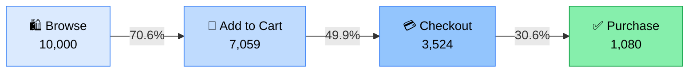

<div align="center">

# 📊 E-Commerce Funnel Analysis

### From first click to final purchase — see exactly where customers drop off, and what to do about it.

[](https://www.python.org/)
[](https://streamlit.io/)
[](https://plotly.com/python/)
[](https://pandas.pydata.org/)
[](https://jupyter.org/)

<p>
  <a href="#-quick-start">🚀 Quick Start</a> •
  <a href="#-key-findings">🔍 Key Findings</a> •
  <a href="#-dashboard-tour">🧭 Dashboard Tour</a> •
  <a href="#-dataset">🗂️ Dataset</a> •
  <a href="#-methodology">🧪 Methodology</a> •
  <a href="#-recommendations">💡 Recommendations</a>
</p>

</div>

---

## 📖 Overview

This project analyzes **10,000 customer sessions (21,663 events)** from an e-commerce store to understand how shoppers move through the purchase journey:

```
🛍️ Browse  ➜  🛒 Add to Cart  ➜  💳 Checkout  ➜  ✅ Purchase
```

It ships in two flavors:

| | 📓 Jupyter Notebook | 🖥️ Streamlit Dashboard |
|---|---|---|
| **File** | `Funnel_Analysis_Report.ipynb` | `app.py` |
| **Best for** | Deep-dive, step-by-step exploration | Interactive filtering & sharing with stakeholders |
| **Outputs** | Charts, tables, Excel + PNG exports | Live KPIs, 6 interactive tabs, Excel download |

---

## ✨ Features

- 🔻 **Funnel visualization** — sessions and drop-off at every stage
- 📣 **Channel analysis** — Organic, Social Media, Email, Google Ads
- 🌍 **Regional analysis** — East, North, South, West
- 📱 **Device & category breakdown** — Desktop / Mobile / Tablet × 5 product categories
- 🕒 **Time trends** — daily and hourly sessions and conversion rates
- 🎛️ **Live sidebar filters** — date range, channel, region, device, category (applied across every tab)
- 💡 **Auto-generated insights** — biggest drop-off, best channel / region / category
- 📥 **One-click Excel export** — all segment tables in a single workbook
- ⚡ **Fast** — cached data loading and session aggregation

---

## 🔍 Key Findings

> Results from the bundled dataset (October 2025).

<table>
<tr>
<td align="center"><h3>10,000</h3>👥 Sessions</td>
<td align="center"><h3>1,080</h3>🧾 Orders</td>
<td align="center"><h3>10.80%</h3>🎯 Conversion</td>
<td align="center"><h3>$1.18M</h3>💰 Revenue</td>
<td align="center"><h3>$1,089</h3>🏷️ Avg Order Value</td>
</tr>
</table>

### 🔻 The Funnel

| Stage | Sessions | % of Browse | Drop-off vs. previous stage |
|---|---:|---:|---:|
| 🛍️ Browse | 10,000 | 100.00% | — |
| 🛒 Add to Cart | 7,059 | 70.59% | 29.41% |
| 💳 Checkout | 3,524 | 35.24% | 50.08% |
| ✅ Purchase | 1,080 | 10.80% | **69.35%** ⚠️ |



> ⚠️ **The biggest leak is at Checkout → Purchase**, where roughly 7 in 10 shoppers who reach checkout leave without buying.

<details>
<summary><b>📣 Conversion by Channel</b> (click to expand)</summary>

<br>

| Channel | Sessions | Conversion | Revenue | AOV |
|---|---:|---:|---:|---:|
| 🌿 Organic | 2,511 | **11.19%** 🏆 | $307,448 | $1,094 |
| 🔎 Google Ads | 2,560 | 11.02% | $312,769 | $1,109 |
| 📱 Social Media | 2,440 | 10.78% | $280,072 | $1,065 |
| ✉️ Email | 2,489 | 10.20% | $276,117 | $1,087 |

</details>

<details>
<summary><b>🌍 Conversion by Region</b> (click to expand)</summary>

<br>

| Region | Sessions | Conversion | Revenue | AOV |
|---|---:|---:|---:|---:|
| South | 2,506 | **11.25%** 🏆 | $311,019 | $1,103 |
| East | 2,514 | 11.14% | $301,767 | $1,078 |
| North | 2,504 | 10.42% | $288,028 | $1,104 |
| West | 2,476 | 10.38% | $275,592 | $1,072 |

</details>

<details>
<summary><b>📱 Conversion by Device</b> (click to expand)</summary>

<br>

| Device | Sessions | Conversion | Revenue | AOV |
|---|---:|---:|---:|---:|
| 🖥️ Desktop | 3,331 | **11.17%** 🏆 | $399,395 | $1,074 |
| 📱 Mobile | 3,345 | 10.85% | $405,452 | $1,117 |
| 📲 Tablet | 3,324 | 10.38% | $371,559 | $1,077 |

</details>

<details>
<summary><b>🛍️ Conversion by Product Category</b> (click to expand)</summary>

<br>

| Category | Sessions | Conversion | Revenue | AOV |
|---|---:|---:|---:|---:|
| 💄 Beauty | 1,978 | **11.43%** 🏆 | $241,835 | $1,070 |
| 🏠 Home | 1,941 | 10.87% | $232,535 | $1,102 |
| 👗 Fashion | 2,035 | 10.81% | $237,262 | $1,078 |
| ⚽ Sports | 2,000 | 10.75% | $238,323 | $1,108 |
| 🔌 Electronics | 2,046 | 10.17% | $226,452 | $1,089 |

</details>

---

## 🚀 Quick Start

### 1️⃣ Clone the repository

```bash
git clone https://github.com/<your-username>/<your-repo>.git
cd <your-repo>
```

### 2️⃣ Install dependencies

```bash
pip install streamlit pandas plotly xlsxwriter
# For the notebook, also:
pip install numpy matplotlib seaborn jupyter openpyxl
```

### 3️⃣ Add the dataset

Place `funnel_analysis_data.csv` in the project root (same folder as `app.py`).

### 4️⃣ Launch the dashboard

```bash
streamlit run app.py
```

Open **http://localhost:8501** in your browser. 🎉

<details>
<summary><b>📓 Prefer the notebook?</b></summary>

<br>

```bash
jupyter notebook Funnel_Analysis_Report.ipynb
```

Run all cells top to bottom. The last cells export `funnel_analysis_report.xlsx` and `funnel_conversion_rates.png`.

</details>

---

## 🧭 Dashboard Tour

The dashboard has a **filter sidebar** and **6 interactive tabs**. Every chart updates instantly when you change a filter.

| Tab | What you'll find |
|---|---|
| 🔻 **Overall Funnel** | Funnel chart, stage drop-off line, revenue and avg. session duration by furthest stage reached |
| 📣 **Channel** | Conversion rate, revenue, AOV, and session share per channel |
| 🌍 **Region** | Funnel progression and conversion rate per region |
| 📱 **Device & Category** | Conversion by device and by product category, with detail tables |
| 🕒 **Time Trends** | Daily sessions and conversion rate, plus hour-of-day patterns |
| 💡 **Recommendations** | Auto-detected biggest drop-off, best performers, action list, Excel export |

### 🎛️ Sidebar Filters

📅 Date range &nbsp;•&nbsp; 📣 Channel &nbsp;•&nbsp; 🌍 Region &nbsp;•&nbsp; 📱 Device &nbsp;•&nbsp; 🛍️ Product Category

### 📈 KPI Bar

`Total Sessions` · `Total Orders` · `Overall Conversion` · `Total Revenue` · `Avg Order Value` · `Bounce Rate`

---

## 🗂️ Dataset

**File:** `funnel_analysis_data.csv` — **21,663 rows × 10 columns**, **2025-10-01 → 2025-10-31**, no missing values or duplicates.

| Column | Type | Description |
|---|---|---|
| `User_ID` | text | Unique user identifier (10,000 users) |
| `Session_ID` | text | Unique session identifier (10,000 sessions) |
| `Event` | text | `Browse`, `Add to Cart`, `Checkout`, `Purchase` |
| `Timestamp` | datetime | When the event happened |
| `Device` | text | `Desktop`, `Mobile`, `Tablet` |
| `Region` | text | `East`, `North`, `South`, `West` |
| `Channel` | text | `Organic`, `Social Media`, `Email`, `Google Ads` |
| `Product_Category` | text | `Beauty`, `Electronics`, `Fashion`, `Home`, `Sports` |
| `Revenue` | float | Order value (0 unless purchased) |
| `Bounce_Flag` | text | `Yes` / `No` |

> 🔒 **Using your own data?** Keep the same column names and event labels and the dashboard will work as-is.

---

## 🧪 Methodology

1. **🧹 Clean** — parse timestamps, check nulls and duplicates, derive `Date`, `DayOfWeek`, `Hour`.
2. **🧱 Sessionize** — collapse events into one row per session (start, end, duration, event list, segment attributes, revenue).
3. **📏 Find furthest stage** — each session is assigned the deepest funnel stage it reached.
4. **🔻 Build the funnel** — a session counts toward a stage if it reached that stage **or any later one**.
5. **📊 Segment** — conversion rate, revenue, AOV, and revenue per session by channel, region, device, and category.
6. **🕒 Trend** — daily and hourly sessions and conversion rates.
7. **💡 Recommend** — surface the biggest drop-off and top performers automatically.

<details>
<summary><b>📐 Metric definitions</b></summary>

<br>

| Metric | Formula |
|---|---|
| **Conversion Rate** | Purchase sessions ÷ total sessions × 100 |
| **Drop-off Rate** | (1 − stage sessions ÷ previous stage sessions) × 100 |
| **AOV** | Total revenue ÷ number of purchases |
| **Revenue / Session** | Total revenue ÷ total sessions |
| **Bounce Rate** | Sessions with `Bounce_Flag = Yes` ÷ total sessions × 100 |

</details>

---

## 💡 Recommendations

1. 🔧 **Fix checkout friction first.** Checkout → Purchase loses ~69% of shoppers. Audit form length, payment options, load time, and trust signals.
2. 💸 **Shift budget toward top converters.** Organic and Google Ads convert best; Email lags the most.
3. 🌍 **Replicate what works in the South and East.** Study their experience and apply it to North and West.
4. 🛍️ **Lift Electronics.** Lowest category conversion at 10.17%, so test clearer specs, reviews, and comparisons.
5. 📧 **Recover abandoned carts.** Reminder emails and retargeting ads on the 3,524 checkout-stage sessions that didn't convert are the highest-leverage opportunity.

---

## 📁 Project Structure

```
📦 funnel-analysis
 ┣ 📜 app.py                         # Streamlit dashboard
 ┣ 📓 Funnel_Analysis_Report.ipynb   # Full exploratory analysis
 ┣ 🗃️ funnel_analysis_data.csv       # Dataset (add this file)
 ┗ 📖 README.md
```

---

## 🛠️ Tech Stack

| Purpose | Tools |
|---|---|
| Data processing |   |
| Visualization |    |
| App framework |  |
| Export |  |

---

## 🗺️ Roadmap

- [ ] 📤 CSV upload directly from the sidebar
- [ ] 👥 Cohort and retention analysis
- [ ] 🔮 Conversion prediction model
- [ ] ☁️ Deploy on Streamlit Community Cloud

---

## 🤝 Contributing

Contributions are welcome!

1. 🍴 Fork the repo
2. 🌿 Create a branch: `git checkout -b feature/amazing-feature`
3. 💾 Commit: `git commit -m "Add amazing feature"`
4. 📤 Push: `git push origin feature/amazing-feature`
5. 🔁 Open a Pull Request


<div align="center">

### ⭐ If you found this useful, give it a star!

Built with ❤️ using Python, Pandas, Plotly & Streamlit

<a href="#-e-commerce-funnel-analysis">⬆️ Back to top</a>

</div>
